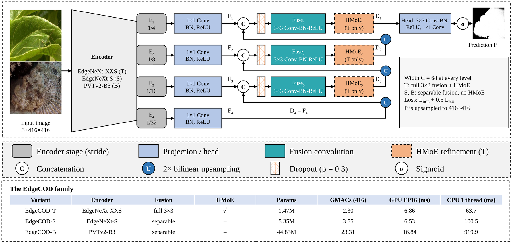
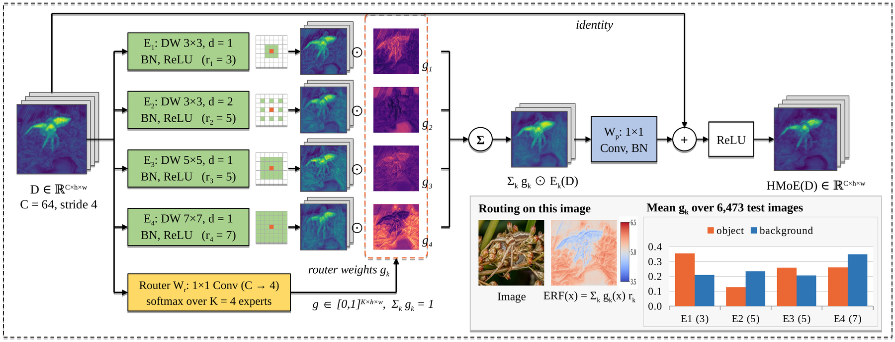
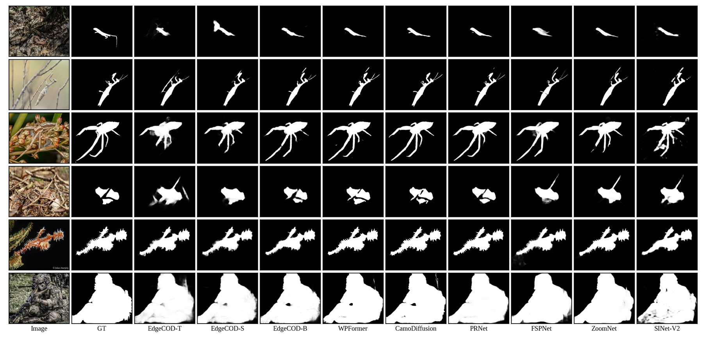

# EdgeCOD: Efficient Camouflaged Object Detection with Spatially Routed Heterogeneous Mixture-of-Experts Refinement

Official PyTorch implementation of the paper published in *Computer Modeling in Engineering & Sciences* (CMES), 2026.
DOI: [10.32604/cmes.2026.094244](https://doi.org/10.32604/cmes.2026.094244)

Kamal Othman, Khaled Alomar, Abdulfattah Noorwali, Hela Elmannai and Habib Khan

<p align="center"></p>

EdgeCOD is a family of efficient camouflaged object detection (COD) networks. It combines a pretrained hierarchical
encoder, a 1x1 neck, a compact top-down decoder and a prediction head. For the smallest model, we add a
**Heterogeneous Mixture-of-Experts (HMoE)** refinement block: a per-pixel router mixes depth-wise experts with
different receptive fields (3x3, 3x3 with dilation 2, 5x5 and 7x7), so every location chooses its own context.

Every design decision was made on a validation split held out from the training data (`splits/val.txt`). The final
models were trained on all 4,040 training images with three seeds and evaluated once on the test sets.

<p align="center"></p>

## Model zoo

| Model | Encoder | Decoder | HMoE | Params | GMACs (416) | GPU FP16 (ms) | CPU 1 thread (ms) |
|---|---|---|:-:|--:|--:|--:|--:|
| EdgeCOD-T | EdgeNeXt-XXS | full | yes | 1.47M | 2.30 | 6.86 | 63.7 |
| EdgeCOD-S | EdgeNeXt-S | separable | no | 5.35M | 3.55 | 6.53 | 100.5 |
| EdgeCOD-B | PVTv2-B3 | separable | no | 44.83M | 23.31 | 16.84 | 919.9 |

Latency at 416 x 416 with batch 1 on an RTX 4090 (FP16) and an Intel i9-10900X (FP32). It was measured with
`tools/benchmark.py`, and the full protocol is described in that script and in Section 4.5 of the paper.

## Results

The table gives the mean over three seeds (2026, 1 and 2), computed with `edgecod/evaluate.py` (PySODMetrics). The
standard deviations are in Table 7 of the paper. E<sub>φ</sub><sup>m</sup> is the mean
E-measure over 256 thresholds.

| Model | CAMO S<sub>α</sub> / F<sub>β</sub><sup>w</sup> / E<sub>φ</sub><sup>m</sup> / MAE | COD10K | NC4K | CHAMELEON |
|---|---|---|---|---|
| EdgeCOD-T | 0.794 / 0.700 / 0.845 / 0.082 | 0.794 / 0.643 / 0.856 / 0.041 | 0.833 / 0.740 / 0.881 / 0.053 | 0.874 / 0.784 / 0.917 / 0.036 |
| EdgeCOD-S | 0.833 / 0.768 / 0.887 / 0.062 | 0.837 / 0.725 / 0.898 / 0.029 | 0.863 / 0.797 / 0.910 / 0.041 | 0.896 / 0.832 / 0.937 / 0.029 |
| EdgeCOD-B | 0.864 / 0.813 / 0.911 / 0.051 | 0.863 / 0.772 / 0.920 / 0.025 | 0.883 / 0.829 / 0.925 / 0.034 | 0.907 / 0.858 / 0.950 / 0.024 |

<p align="center"></p>

## Downloads

The prediction maps are attached to the [v1.0 release](https://github.com/habib1402/EdgeCOD/releases/tag/v1.0).

| File | Content |
|---|---|
| `EdgeCOD-T_prediction_maps.zip` | EdgeCOD-T, seeds 2026, 1 and 2 |
| `EdgeCOD-S_prediction_maps.zip` | EdgeCOD-S, seeds 2026, 1 and 2 |
| `EdgeCOD-B_prediction_maps.zip` | EdgeCOD-B, seeds 2026, 1 and 2 |

Each archive holds `seed<k>/<dataset>/<name>.png` for CAMO, COD10K, NC4K and CHAMELEON (8-bit probability maps at
the ground-truth size). The results table above can be reproduced from these maps with `tools/score_maps.py`.

## Installation

```bash
git clone https://github.com/habib1402/EdgeCOD.git
cd EdgeCOD
pip install -r requirements.txt
```

We used Python 3.9, PyTorch 2.8, timm 1.0.30 and PySODMetrics 1.6.2. The ImageNet weights of the encoders are
downloaded by timm on the first run.

## Data

We use the standard COD benchmark split: 4,040 training images (3,040 from COD10K and 1,000 from CAMO) and the test
sets of CAMO, COD10K, NC4K and CHAMELEON. They are available, for example, from the
[SINet-V2 repository](https://github.com/GewelsJI/SINet-V2). Arrange them as follows (or set `data.root`):

```
data/
  TrainDataset/CAMO+COD10K/Image/*.jpg     TrainDataset/CAMO+COD10K/GT/*.png
  TestDataset/{CAMO,COD10K,NC4K,CHAMELEON}/Imgs/*.jpg
  TestDataset/{CAMO,COD10K,NC4K,CHAMELEON}/GT/*.png
```

Only images that have a ground-truth mask are used.

## Testing

Evaluate a checkpoint trained with `train.py` (saved as `runs/<run>/last.pth`):

```bash
python test.py --config configs/edgecod_s.yaml --weights runs/edgecod_s_s2026/last.pth --out results/edgecod_s_s2026
```

This writes the scores to `results/edgecod_s_s2026/results_last.json` and the prediction maps to
`results/edgecod_s_s2026/maps/last/<dataset>/`.

To run a trained model on your own images:

```bash
python predict.py --config configs/edgecod_s.yaml --weights runs/edgecod_s_s2026/last.pth \
    --input path/to/images --out path/to/maps --overlay
```

## Training

```bash
# one final model (80 epochs, AdamW + cosine, multi-scale 384/416/448, BCE + 0.5 IoU; Table 3 of the paper)
python train.py --config configs/edgecod_t.yaml --run edgecod_t_s2026
python train.py --config configs/edgecod_t.yaml --run edgecod_t_s1 --set seed=1

# design study on the validation split (404 images, splits/val.txt); the test sets are not used
python train.py --config configs/edgecod_t.yaml --run val_t --set data.holdout=0.1 "data.test=[]"
```

Any configuration key can be changed with `--set key=value`, for example `model.hmoe=false`,
`model.separable=true`, `data.test_size=384` or `loss.iou_weight=0.3`. The checkpoint after the last epoch is
evaluated, with no early stopping or checkpoint selection. At batch size 8 with bf16 mixed precision, the peak
allocated GPU memory during training was 0.8 GB (T), 1.4 GB (S) and 4.9 GB (B) on an RTX 4090.

## Evaluation tools

```bash
# score any folder of maps with the evaluation code used for all methods in the paper
# (for the released maps: unzip EdgeCOD-S_prediction_maps.zip and use --pred EdgeCOD-S_maps/seed2026)
python tools/score_maps.py --pred results/edgecod_s_s2026/maps/last --gt_root data/TestDataset --per_image per_image/s_s2026

# paired bootstrap (10,000 resamples, 95% CI) between two models, seeds averaged per image
python tools/bootstrap.py --a per_image/t_s2026 per_image/t_s1 per_image/t_s2 --b per_image/s_s2026 per_image/s_s1 per_image/s_s2

# parameters, GMACs, GPU and CPU latency
python tools/benchmark.py --config configs/edgecod_t.yaml configs/edgecod_s.yaml configs/edgecod_b.yaml
```

## Citation

```bibtex
@article{othman2026edgecod,
  title   = {EdgeCOD: Efficient Camouflaged Object Detection with Spatially Routed Heterogeneous Mixture-of-Experts Refinement},
  author  = {Othman, Kamal and Alomar, Khaled and Noorwali, Abdulfattah and Elmannai, Hela and Khan, Habib},
  journal = {Computer Modeling in Engineering \& Sciences},
  year    = {2026},
  doi     = {10.32604/cmes.2026.094244}
}
```

## Acknowledgment

The authors would like to thank Princess Nourah bint Abdulrahman University Researchers Supporting Project number
(PNURSP2026R747), Princess Nourah bint Abdulrahman University, Riyadh, Saudi Arabia. We thank the authors of
[timm](https://github.com/huggingface/pytorch-image-models), [EdgeNeXt](https://github.com/mmaaz60/EdgeNeXt),
[PVTv2](https://github.com/whai362/PVT) and [PySODMetrics](https://github.com/lartpang/PySODMetrics).

## License

This code is released under the MIT License (see `LICENSE`).
